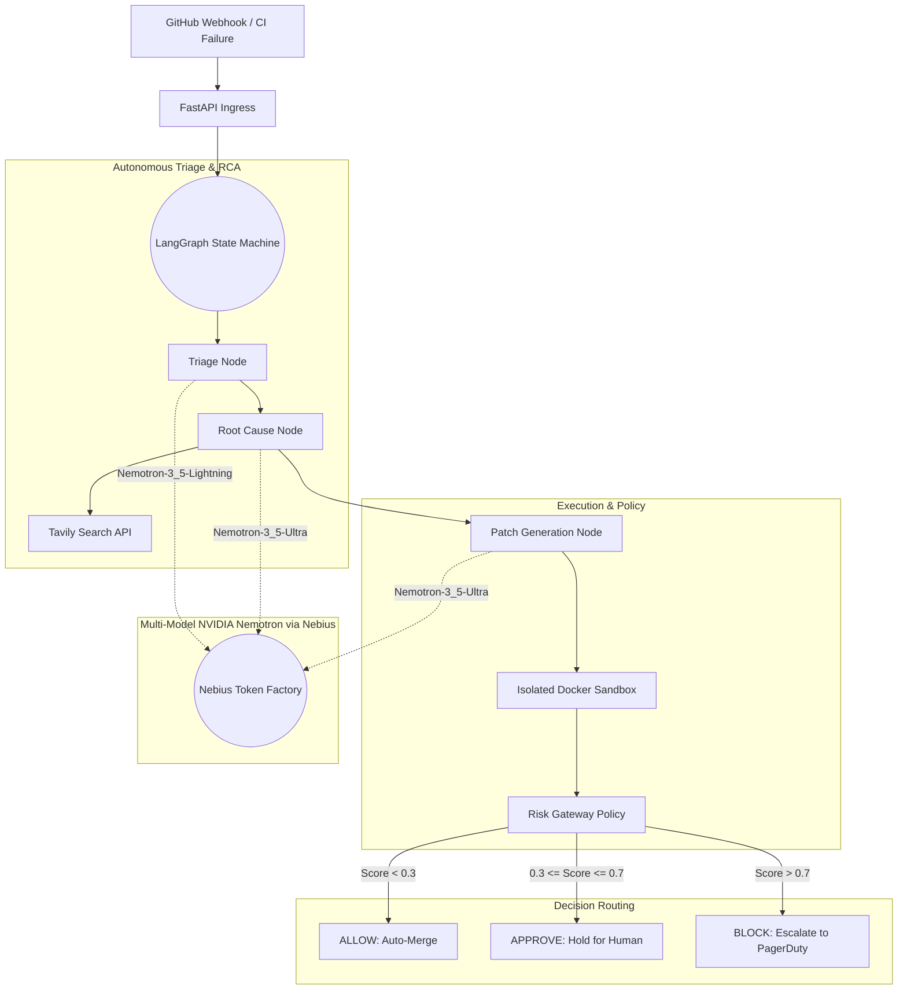

# AegisCore : Autonomous Reliability Engine (ARE)

**One-Paragraph Pitch**: AegisCore is a stateful, agentic CI/CD self-healing pipeline. When a build breaks, AegisCore intercepts the webhook, spins up an NVIDIA Nemotron agent via the Nebius Token Factory to triage and isolate the root cause, and uses Tavily to cross-reference known issues. It then writes a patch, tests it in an isolated Docker sandbox, calculates a deterministic risk score to decide if it's safe to auto-merge (ALLOW), hold for human review (APPROVE), or escalate (BLOCK), and opens a pull request—turning your pipeline from a passive alarm into an active, self-healing organism.

**Hackathon Track**: Coding and Agentic Engineering

## 🏗️ Architecture Diagram


## 🧠 Powered by Nebius Token Factory & NVIDIA Nemotron

This project is built from the ground up to leverage real-time LLM inference using **NVIDIA Nemotron** hosted on the **Nebius Token Factory**.

### Multi-Model Tiering Strategy
We deploy a multi-model tiering architecture to balance latency and reasoning depth, all routed through the Nebius OpenAI-compatible endpoint (`https://api.tokenfactory.nebius.com/v1`).

1. **Triage Node**: Uses `nvidia/Nemotron-3_5-Lightning`. This node acts as the ultra-fast first responder to incoming webhooks, parsing error signatures and stack traces to determine if an actionable bug exists.
2. **Root Cause Analysis (RCA) Node**: Escalates to `nvidia/Nemotron-3_5-Ultra`. It ingests the stack trace, sanitized file context, and Tavily web research to perform deep logical deduction.
3. **Patch Generation Node**: Stays on `nvidia/Nemotron-3_5-Ultra` to synthesize a syntax-perfect, unified diff code patch and generate isolated regression tests.

### Fail-Loud LLM Contract
Our system is built for enterprise reliability. If Nemotron inference fails at any point in the pipeline (e.g., during patch generation), the LangGraph state machine **fails loudly** and emits an `inference_failed` telemetry event. There are **no silent fallbacks** to rule-based logic—if the AI can't generate a patch, the pipeline securely escalates to a human operator.

## ⚙️ Core Pipeline / Agent Flow

The backend orchestrates the workflow using a strongly typed `RecoveryState` within a **LangGraph** state machine:

1. **Observe (GitHub Webhook)**: Ingest CI failure payload.
2. **Reason (Triage & RCA)**: Nemotron diagnoses the failure mechanism.
3. **Propose (Patch Generation)**: Nemotron generates the minimal safe code change.
4. **Evaluate (Risk Gateway)**: A deterministic algorithm calculates a risk score based on file criticality, patch scope, and change surface.
5. **Execute & Verify (Docker Sandbox)**: The patch is applied and validated using `pytest` inside an isolated, network-disabled Docker container (512MB RAM, 1 CPU).
6. **Authorize (Human-in-the-Loop)**: If the risk score dictates it, the process pauses. The operator reviews the patch, risk breakdown, and test results before approving.
7. **Deliver (GitHub PR)**: A new branch is created, and the verified patch is submitted as a Pull Request.

## 🛠️ Tech Stack

*   **AI Runtime**: NVIDIA Nemotron (via Nebius Token Factory)
*   **Agent Orchestration**: LangGraph
*   **Backend**: FastAPI, PostgreSQL, SQLAlchemy (AsyncPG)
*   **Execution Sandbox**: Docker
*   **Integrations**: PyGithub, Tavily Search API
*   **Frontend**: Next.js 14, Tailwind CSS, Monaco Editor
*   **Real-time Communication**: Server-Sent Events (SSE)

## ✨ Key Features

*   **Real-Time Mission Control**: Watch the LangGraph execution live via SSE telemetry.
*   **Explainable Risk Gateway**: Model output is never blindly trusted. The risk score (ALLOW, APPROVE, BLOCK) is deterministically calculated.
*   **Isolated Verification**: Code is never executed in the FastAPI process; it is strictly sandboxed.
*   **Human-in-the-Loop**: A first-class state machine checkpoint for operator authorization.
*   **Adversarial Resilience**: Built-in supply-chain CVE checking and behavioral gating.
*   **Multi-Tenant Isolation**: Secure Redis-backed OAuth sessions and incident scoping.

## 🚀 How to Run

### Requirements
*   Docker & Docker Compose
*   A valid **Nebius API Key**
*   A GitHub Personal Access Token

### Setup
1. Clone the repository:
   ```bash
   git clone <repository-url>
   cd autonomous-recovery-engine
   ```
2. Configure the environment:
   ```bash
   cp .env.example .env
   ```
3. Populate `.env` with your critical credentials:
   ```ini
   NEBIUS_API_KEY=your_nebius_api_key
   NEBIUS_FAST_MODEL=nvidia/Nemotron-3_5-Lightning
   NEBIUS_STRONG_MODEL=nvidia/Nemotron-3_5-Ultra
   GITHUB_TOKEN=your_github_token
   GITHUB_WEBHOOK_SECRET=your_webhook_secret
   ```
4. Start the stack:
   ```bash
   docker compose -f docker-compose.prod.yml up --build
   ```
   *Backend runs on `http://localhost:8000`, Frontend on `http://localhost:3000`.*

## 📁 Project Structure

```
autonomous-recovery-engine/
├── backend/
│   ├── api/            # FastAPI routes (webhooks, incidents, remediate)
│   ├── orchestration/  # LangGraph state machine, nodes, prompts
│   ├── llm/            # Nebius API client implementation
│   ├── tools/          # Docker sandbox integration
│   ├── db/             # SQLAlchemy models
│   └── main.py
├── frontend/           # Next.js UI (Mission Control dashboard)
├── tests/              # Comprehensive pytest suite
├── deploy/             # Docker Compose configurations
└── sandbox/            # Example vulnerable application for testing
```

## 📄 License
MIT License
