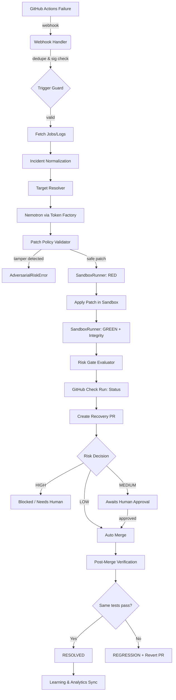
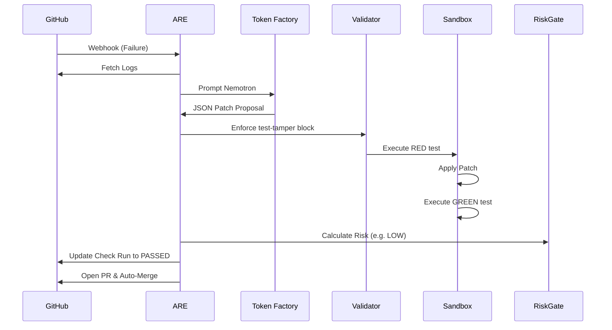

# Architecture Specification

## Current vs Target Architecture

### Current Architecture (ASCII)
```text
GitHub Push -> Webhook -> /webhook/github (skips log fetch) 
                       -> LangGraph Runtime
                       -> repair_node (Nemotron) 
                       -> sandbox_node (Docker, runs tests once)
                       -> risk_node (Static)
                       -> GitHub PR (No check run)
                       -> END
```

### Target Architecture (Mermaid)


## Component Table

| Component | Responsibility | Enforcement Point |
|---|---|---|
| `WebhookHandler` | Dedupes, signature check, fetches raw logs | `backend/api/webhooks.py` |
| `TargetResolver` | Extracts traceback and resolves deepest non-test code frame | `backend/orchestration/state_factory.py` |
| `NemotronClient` | Orchestrates LLM prompt and response via Nebius Token Factory | `backend/llm/nebius.py` |
| `PatchValidator` | Blocks test/CI modifications, parses paths | `backend/orchestration/nodes.py:repair_node` |
| `SandboxRunner` | Isolates code execution, verifies RED/GREEN and integrity | `backend/sandbox/sandbox.py` |
| `RiskGate` | Calculates risk scores deterministically based on diff volume/criticality | `backend/orchestration/risk.py` |
| `GitHubIntegration` | Handles Check Runs API and PR lifecycles | `backend/integrations/github_pr.py` |

## JSON Schemas

### Incident
```json
{
  "type": "object",
  "properties": {
    "incident_id": {"type": "string"},
    "repo": {"type": "string"},
    "run_id": {"type": "string"},
    "exception_type": {"type": "string"},
    "traceback": {"type": "string"},
    "resolved_target": {"type": "string"}
  }
}
```

### EvidenceBundle
```json
{
  "type": "object",
  "properties": {
    "patch_hash": {"type": "string"},
    "sandbox_red": {"type": "string"},
    "sandbox_green": {"type": "string"},
    "risk_breakdown": {"type": "object"},
    "pr_url": {"type": "string"},
    "merge_sha": {"type": "string"},
    "post_merge_result": {"type": "string"}
  }
}
```

## State Machine & SSE Events
1. `pending` -> `ingesting` (Event: `incident_ingested`)
2. `ingesting` -> `resolving` (Event: `target_resolved`)
3. `resolving` -> `analyzing` (Event: `patch_generation_started`)
4. `analyzing` -> `validating` (Event: `patch_policy_validated`)
5. `validating` -> `sandboxing` (Event: `sandbox_started`)
6. `sandboxing` -> `risk_evaluation` (Event: `sandbox_completed`)
7. `risk_evaluation` -> `pr_creation` (Event: `risk_evaluated`)
8. `pr_creation` -> `awaiting_merge` (Event: `pr_created`)
9. `awaiting_merge` -> `post_merge_verifying` (Event: `merge_detected`)
10. `post_merge_verifying` -> `resolved` (Event: `incident_resolved`)

## SandboxRunner Interface
```python
class SandboxRunner(Protocol):
    async def setup(self, commit_sha: str) -> None: ...
    async def run_test(self, command: str) -> SandboxRun: ...
    async def apply_patch(self, diff: str) -> None: ...
    async def verify_integrity(self) -> bool: ...
```
**Implementations:**
- `LocalDockerRunner`: Uses `subprocess` interacting with local Docker daemons.
- `NebiusSandboxRunner`: Pluggable for future official Nebius Token Factory sandboxes.

## Risk Configuration & Worked Example
- **Config:** `<10 lines added` (0.05), `>=10 lines added` (0.20), `backend/api/auth.py` (0.35).
- **Example:** Patch edits `auth.py` modifying 2 lines. Total = 0.35 (Critical File) + 0.05 (Volume) = 0.40 (MEDIUM). Requires human approval.

## Resolver Algorithm
1. Parse raw GitHub logs for `Traceback (most recent call last):`.
2. Extract all stack frames.
3. Reverse traverse frames.
4. Skip paths matching `test_*.py` or `tests/`.
5. Return the first matching repository application source file.
6. If none found, return `AMBIGUOUS_TARGET`.

## Sequence Diagrams (Happy Path)


## Trust Boundaries
- **Untrusted:** GitHub raw logs, commit messages, LLM outputs.
- **Trusted:** Internal diff parser, Sandbox test exit codes, cryptographic signatures.
- **Enforcement:** LLM output is strictly bounded as data strings. Executable environments (Sandbox) are isolated and stripped of API keys.
